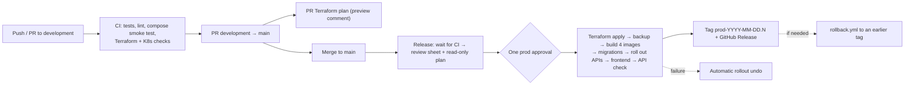
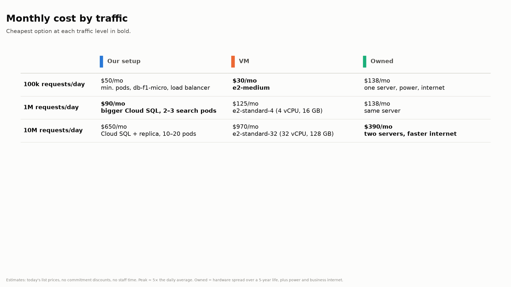
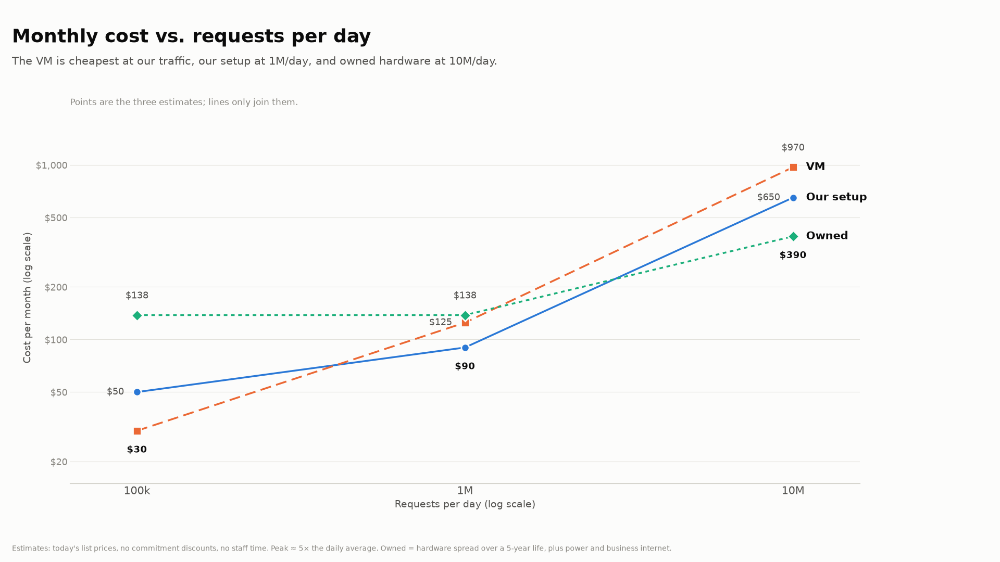

# Lecture Indexer Elements Summary

Top-level talking points for the final presentation. Each point names the doc with the full detail.

## 1. Technical Components

### 1.1 Front-End Layer

- **Purpose:** The web app where users sign in with Google. Students browse courses and search transcripts, and hits play in an embedded YouTube player at the matching timestamp. Professors create courses and register lectures, and admins manage invitations and roles.
- **Framework:** React 19 + Vite + TypeScript single-page app, served by nginx in a container. Google Sign-In (OAuth 2.0 / OIDC).
- **Cloud Hosting:** Google Cloud Run, service `li-frontend`, public, scales from 0 to 2 instances.
- **Rationale:**
  - The proposal put the frontend on Azure Static Web Apps. Our Azure for Students subscription only allows five regions, and Static Web Apps isn't offered in any of them ([ADR 0001](docs/architecture_decision_records/0001-frontend-on-cloud-run.md)).
  - Cloud Run is a host the course allows, scales to zero (about $0 for our traffic), and reuses our Docker images, Artifact Registry and deploy identity.
  - nginx lets us set security headers, including the Content-Security-Policy.

### 1.2 Application Tier

- **Purpose:** Two REST APIs.
  - **Ingest API** (`/ingest/*`): sign-in and roles, courses, lecture registration (pulls YouTube captions and stores them as searchable segments), and admin user management.
  - **Search API** (`/search/*`): full-text search over a course's transcripts.
- **Framework:** Python 3.12 Flask, served by gunicorn. Shared package `li_common` provides auth, validation (pydantic), JSON errors and health checks.
- **Cloud Hosting:** GKE Autopilot (private nodes, Spot pods) behind a Google HTTPS load balancer with a Google-managed certificate. Each pod connects to the database through a Cloud SQL Auth Proxy sidecar.
  - **How are we scaling and at what thresholds?**
    - Each service has a Horizontal Pod Autoscaler that targets **70% average CPU**, measured against each pod's 250m CPU request.
    - **Ingest: 1 to 4 pods. Search: 1 to 6 pods.** Search gets more because it's the read-heavy path that students use.
    - Autopilot adds and removes nodes for the pods automatically, so we never manage VMs.
    - The frontend scales separately on Cloud Run (0 to 2 instances, by request load).
    - The database (Cloud SQL `db-f1-micro`) doesn't autoscale. It's the first thing to upsize for real load.
- **Rationale:**
  - Splitting ingest and search lets each scale on its own, and gives each its own least-privilege database role. Search is read-mostly.
  - We used Flask because the team knows it. What FastAPI would have given us lives in `li_common`.
  - Ingestion runs inside the request, with no queue: a lecture takes a few seconds.

### 1.3 Data Tier

- **Purpose:** Stores users, courses, lectures and timestamped caption segments, and runs the search.
- **Framework:** PostgreSQL 16 with its built-in full-text search (`tsvector` + GIN index). Plain numbered `.sql` migrations, applied by a Kubernetes Job before each rollout. No ORM.
- **Cloud Hosting:** Cloud SQL for PostgreSQL (`li-pg`, `db-f1-micro`, 10 GB SSD), **private IP only**. Services log in as IAM database users, and nobody uses a password except the admin and migration tools.
  - **Backups:** a nightly CronJob runs `pg_dump`, encrypts it with `age`, and uploads it to immutable Azure Blob Storage ([ADR 0004](docs/architecture_decision_records/0004-database-backups-to-azure.md)). Every release with migrations also takes a Cloud SQL backup first.
- **Rationale:**
  - A managed database means no patching or failover work for us.
  - Postgres full-text search avoids running a separate search engine such as Elasticsearch: one system, one backup.
  - The private IP means the database can't be reached from the internet.

### 1.4 CI/CD

#### 1.4.1 Continuous Integration

- **Purpose:** Catch problems on every push and pull request, before anything reaches production.
- **Implementation:** GitHub Actions, `.github/workflows/ci.yml`, with no cloud credentials. Eight jobs:
  - Python lint and tests against a real Postgres
  - a full `docker compose` stack with a smoke test (sign-in, roles, course creation, search)
  - Terraform `fmt`, `validate` and mocked `terraform test`
  - Kubernetes manifest validation (`kustomize` + `kubeconform`)
  - documentation link checks
  - frontend lint, tests and build
  - frontend and backup image tests
- **Rationale:**
  - Tests run against real Postgres, not mocks, so the search SQL is actually exercised.
  - CI has no credentials, so a pull request can't touch production.

#### 1.4.2 Continuous Delivery

- **Purpose:** Get `main` into production safely, with one human approval, automatic undo if a step fails, and a record of every release.
- **Implementation:**
  - `release.yml` runs on every push to `main` ([release process](docs/release-process.md)):
    1. It waits for CI to pass on the commit, then builds a review sheet and a **read-only** Terraform plan.
    2. **One approval** in the `prod` GitHub environment.
    3. It applies that exact plan, takes a backup if there are new migrations, builds and pushes 4 images tagged with the commit SHA, and runs the migrations.
    4. It rolls out the APIs (automatic `kubectl rollout undo` on failure). The frontend deploys to Cloud Run with no traffic, is checked, then gets the traffic.
    5. It checks the API through the load balancer, then tags the commit `prod-YYYY-MM-DD.N` and creates a GitHub Release.
  - `rollback.yml` redeploys any earlier tag.
  - Sign-in to both clouds is **keyless** (OIDC / Workload Identity): CI holds no keys.
- **Rationale:**
  - Our first deploy needed three workflows and three approvals, ran in no fixed order, and showed the plan only after approval. One pipeline fixed all three.
  - Migrations follow "expand first, contract later", so rolling back the code never needs a database rollback.

#### 1.4.3 Diagram of Flow

### 1.5 Terraform

- **Purpose:** All infrastructure on both clouds as code: reviewable, repeatable, and something we can destroy and re-create.
- **Implementation:** Terraform 1.16 with the Google, AzureRM/AzAPI and Grafana providers, and one state bucket in GCS.
  - **Reusable modules:** network, GKE, Cloud SQL, Artifact Registry, Secret Manager, Cloud Run frontend, monitoring, Azure backup storage.
  - **Separate roots:**
    - `bootstrap/` (applied once by hand): CI identities, backup storage, Grafana identities
    - `envs/prod/`: the app environment, applied by the release pipeline
    - `grafana/` (applied by hand): the dashboard
  - Mocked `terraform test` runs in CI.
- **Rationale:**
  - `envs/prod` can be destroyed to save money while backups and identities survive in `bootstrap/`.
  - **No secrets in state:** the repo is public and plan identities can read state, so we use write-only arguments, and scripts create the credentials outside Terraform.

### 1.6 Monitoring

- **Purpose:** One page showing whether both clouds are healthy, plus an alert when a backup fails.
- **Framework:** A Grafana Cloud (free tier) dashboard that queries Google Cloud Monitoring and Azure Monitor directly ([ADR 0005](docs/architecture_decision_records/0005-monitoring-on-grafana-cloud.md), [dashboard reference](docs/monitoring/dashboard.md)).
  - **Health tiles:** database, backups, frontend, load balancer, ingest pods, search pods
  - **Charts:** Cloud Run, load balancer, GKE pods/CPU, Cloud SQL, ingestion/search/backup counts (from log-based metrics), Azure backup storage
  - **Uptime checks** from 3 US regions every 5 minutes
  - **Alert:** "Database backup failed", which stays in Cloud Monitoring
- **Rationale:**
  - Both clouds on one page, with nothing for us to host. Data stays in each cloud.
  - Grafana's credentials are **read-only** and limited to monitoring data.
  - Alerts stay in Cloud Monitoring, so a Grafana outage can't silence them.
  - Known gap: only backup failures alert. Outages show on the dashboard only.

### 1.7 Security

#### 1.7.1 Identity Management

- **Purpose:** Know who every user and every machine is.
- **Implementation:**
  - **Users:** Google Sign-In. The APIs verify the Google ID token on every request. Sign-in is **invite-only**: an admin invites an email, and the first sign-in with that verified email claims the invitation ([ADR 0002](docs/architecture_decision_records/0002-invite-only-users-and-admin-roles.md)).
  - **Workloads:** GKE Workload Identity gives each pod its own Google service account, and those log in to Cloud SQL as IAM users.
  - **CI:** keyless OIDC federation to GCP and Azure, limited to this repo.
- **Rationale:**
  - We store no passwords for users.
  - Pods and CI hold no long-lived keys.
  - Only invited people get in.

#### 1.7.2 Access Control

- **Purpose:** Each user, service and pipeline can only do what it needs.
- **Implementation:**
  - **App roles in the database:** student (search), professor (courses and lectures), plus an `is_admin` flag (invite, change roles, disable accounts) ([ADR 0003](docs/architecture_decision_records/0003-merge-superuser-into-admin.md)). Every change is written to the `user_audit` table and takes effect on the next request.
  - **Database:** `li_ingest_role` can read and write. `li_search_role` can read, plus claim invitations.
  - **CI:** read-only identities for plans. Write identities only exist in the `prod` environment, which needs an approval and only allows `main`.
  - **Network:**
    - private GKE nodes and private-IP Cloud SQL
    - NetworkPolicy: pods accept traffic only from Google's load balancer
    - non-root containers with read-only filesystems and all capabilities dropped
- **Rationale:**
  - Least privilege at every layer.
  - Roles live in the database, not a config file, so changing one doesn't need a release and doesn't publish emails.

#### 1.7.3 Secrets Management

- **Purpose:** Keep the few secrets we have out of code, Git, logs and Terraform state.
- **Implementation:**
  - **Google Secret Manager** holds the database admin password and the backup upload SAS. They're mounted into pods through the Secret Manager CSI driver, and each secret has its own list of allowed readers.
  - The admin password is generated by Terraform but written with **write-only arguments**, so it never lands in state. It's rotated by bumping a version number.
  - The backup credential is a **create-only** SAS: it can't read, list or delete.
  - Backups are encrypted with `age`. The private key is kept offline.
- **Rationale:**
  - The repo is public, and read-only plan identities can read state.
  - Keyless CI means no deploy tokens exist to leak.

### 1.8 Multi-cloud requirement

- **Implementation:**
  - **Google Cloud:** frontend, APIs, database, secrets, CI/CD target.
  - **Microsoft Azure:**
    - encrypted, immutable database backups (Blob Storage, Cool tier, 30-day immutability, deleted at 35 days)
    - Azure Monitor metrics for that storage
    - CI identities that manage it
  - **Grafana Cloud** shows both clouds on one dashboard.
  - Terraform manages both clouds, and CI signs in to both without keys.
- **Rationale:**
  - Backups in a different cloud survive a Google-side failure, account problem, or `terraform destroy`.
  - Azure's share is smaller than proposed because of the student subscription's region policy (ADR 0001). Explain this in the talk.

### 1.9 Documentation

- **Purpose:** Anyone on the team can understand, run, release, fix or restore the system without asking the person who built it.
- **Implementation:** Markdown in `docs/`, checked in CI (links, anchors, paths):
  - [architecture](docs/architecture.md) with a decisions table, and 5 ADRs for the bigger changes
  - runbooks: bootstrap, backup/restore, monitoring, team access
  - the [release process](docs/release-process.md), [security notes](docs/security/review-notes.md), [search explainer](docs/search/transcript-search.md) and the [dashboard reference](docs/monitoring/dashboard.md)
  - an AI usage log for every session
- **Rationale:**
  - Docs live next to the code they describe and are reviewed with it.
  - ADRs record *why* we changed the plan, which feeds the reports and this presentation.

### 1.10 Explain Text Search Vector

**How does our search work?** ([full explainer](docs/search/transcript-search.md))

1. **Ingest:** YouTube's auto-generated captions are merged into **segments** of up to 20 seconds or 400 characters. Each segment is one row with its start time and text.
2. **`tsvector`:** Postgres automatically stores a searchable form of each segment's text in a generated column:
   - It lowercases words, stems them to a root ("recursion", "recursive" → `recurs`), drops stop words, and keeps word positions.
   - It's a sorted list of words, **not** an AI embedding.
3. **GIN index:** works like a textbook index, mapping each word to the segments that contain it. A search intersects those lists, so its cost depends on the number of matches, not the table size.
4. **Query:**
   - `websearch_to_tsquery` turns the user's input into the same stemmed form. It supports `"exact phrase"`, `or` and `-exclude`.
   - `@@` finds the matches.
   - `ts_rank_cd` ranks them higher when the search words appear close together.
   - `ts_headline` builds the highlighted excerpt.
5. **Result:** each hit links to `youtube.com/watch?v=…&t=<seconds>s`, so it opens the video where the words are spoken.
6. **Limits:** it matches word forms, not meaning ("loop" won't find "iteration"), with no typo tolerance, and English only.

## 2. Final Presentation

### 2.1 Live system demonstration

- **Before the presentation:** run `make cloud-resume` well ahead of time. Cloud SQL takes ~15–20 min and the load balancer another 5–10. Check with `make cloud-status` and the Grafana health tiles.
- **End-to-end test**
  - **Ingest**
    1. Have the professor's YouTube account and a video with auto-generated captions ready.
    2. An admin invites the professor's email on the Admin page (as professor).
    3. The professor logs in with Google.
    4. On Manage, create a course and register the video (YouTube consent popup).
    5. See the lecture listed as indexed.
  - **Search**
    1. Have the student's Google account ready.
    2. An admin invites the student (as student).
    3. The student logs in.
    4. Search the course. Show highlighted excerpts, then click a hit and the embedded player starts at that timestamp. Try a phrase in quotes and a `-word` exclusion.
- **Monitoring**
  - **Failure display?**
    - `make cloud-pause` takes a backup first, then stops the pods, load balancer and database. The health tiles go Down (pods within ~3 min, uptime checks within ~5–15 min).
    - `make cloud-resume` brings them back up.
    - Resume takes 20–30 min, so do it at the end of the demo or record it beforehand.
  - **Scaling display?**
    - The HPA scales on CPU above 70%, so sustained search requests would scale Search past 1 pod. Watch with `kubectl get hpa -w` and the GKE pod-count chart.
    - A load script needs a real Google ID token: dev auth is disabled in Kubernetes. Sign in as the student, copy the token from the browser's network tab (it lasts ~1 hour), then run a load tool such as `hey` or `ab` against `/search/courses/<id>/segments?q=...` with `Authorization: Bearer <token>`.
    - Scale-up takes a minute or two to show, and scale-down ~5 min.

### 2.2 Architecture presentation

- **Architecture diagram:** use the Mermaid diagram in [docs/architecture.md](docs/architecture.md) (users → Cloud Run frontend and load balancer → GKE Ingest/Search → Cloud SQL; Backup CronJob → Azure Blob; Cloud Monitoring and Azure Monitor → Grafana; GitHub Actions → both clouds).
- **Each tech choice from above:** walk through §1.1–1.9 with Purpose → Implementation/Framework → Rationale. Call out the three plan changes and why we made them:
  - frontend moved to Cloud Run (ADR 0001)
  - invite-only sign-in with admin roles (ADR 0002/0003)
  - backups to Azure as the multi-cloud piece (ADR 0004)

### 2.3 Cost Analysis

Measured today ([bootstrap runbook §7](docs/runbooks/bootstrap.md)):
- **Running:** about $40–60/month: load balancer ~$18, Cloud SQL ~$11, pods $10–25, Cloud Run ~$0, and the GKE cluster fee covered by free credit.
- **Paused:** about $9/month (database storage + reserved IP).

**Comparison: our setup vs. one VM vs. owning the hardware.** The estimates below are **rough and still to be checked** in the GCP pricing calculator. They scale by **requests per day**, not users, because that is what drives load. Three caveats:
- Capacity is sized for the **peak**, about 5× the daily average (class hours, exam weeks). 1M requests/day ≈ 12 req/s average, ≈ 60 req/s at peak. Our pods and Cloud Run follow the curve; a VM or a server must be bought for the peak.
- Searches are one GIN-indexed query and cheap. Lecture imports use YouTube API quota (10,000 units/day, ~252 per lecture) and are counted separately.
- Egress grows with traffic on every option: at ~5 KB per response, 10M/day ≈ 1.5 TB/month ≈ $130–180.

Monthly cost (owned hardware spread over a 5-year life):

| Requests/day (peak req/s) | Our setup | One VM sized for the peak (all-in-one, runs 24/7) | Owned server |
|---|---|---|---|
| 100k (≤6) | **~$50**: minimum pods, `db-f1-micro`, load balancer (~$9 paused) | **~$30**: e2-medium | **~$138**: ~$1,700 server + UPS, power, business internet |
| 1M (~60) | **~$90**: bigger Cloud SQL tier, 2–3 search pods | **~$125**: e2-standard-4 (4 vCPU, 16 GB) + disk, IP, egress | **~$138**: same server |
| 10M (~600) | **~$650**: Cloud SQL + read replica, 10–20 Spot pods, egress, Cloud Armor | **~$970**: e2-standard-32 (32 vCPU, 128 GB, the largest e2) + SSD, IP, egress | **~$390**: ~$9,000 for two servers, faster internet |

- **At our traffic (100k/day), the VM is cheapest** (~$30 vs. ~$50/mo), because it puts the database and HTTPS on the same box instead of paying ~$29/mo for Cloud SQL and the load balancer.
- **At 1M/day, our setup is cheapest.** A VM sized for the peak runs at full size all day, while our pods and database only grow as far as the load needs. Owned hardware costs the same as at 100k: the internet line dominates.
- **At 10M/day, owned hardware is cheapest** once the purchase is spread over 5 years. The VM is the most expensive and has no bigger e2 to grow into.
- **What the numbers leave out:** staff time. A VM or a server needs patching, backups and certificate renewal, roughly 2–8 h/month; at 4 h × $30/h that adds ~$120/month to the VM and owned options, which erases the VM's lead at our traffic and widens ours at 1M/day. Committed-use discounts (~25–55% off) lower the cloud costs. If the university hosted the server for free (no internet bill), owning would cost ~$38/mo at 100k and 1M: about the VM's price at our traffic and the cheapest option at 1M/day.
- **Why we still chose this setup:** the VM has no autoscaling, managed backups or HTTPS load balancer and is a single point of failure, and sizing it for the peak means paying for peak capacity all day. Owned hardware has single-site risk (power, network) and must be bought weeks ahead. Ours costs more at the low end, pauses to ~$9, and scales without being re-architected.
- The figures are generated by `scripts/cost_charts.py`; change a price there and re-run (`uv run --with matplotlib python scripts/cost_charts.py`).

### 2.4 AI Usage reflection

- **Summarize ai_usage logs:** 9 logged Claude Code sessions in [docs/ai_usage/](docs/ai_usage/): 5 in Milestone 2 (Oct 13–29) and 4 in Milestone 3 (Oct 31–Nov 1, including docs, resource tags and monitoring).
- **How did we use AI?**
  - Claude Code proposed the repo layout and implementation plan.
  - It wrote most of the services, Terraform, Kubernetes config, CI/CD workflows and frontend.
  - It helped run the real Google/YouTube test, diagnosed failed releases, and drafted docs, ADRs and the reports.
  - About two thirds of the M2 commits are co-authored by Claude.
- **How did we verify output?**
  - The team made the design decisions and approved every plan before it was built.
  - CI tests run against real Postgres, and a compose smoke test runs on every push.
  - We read Terraform plans and approved every release ourselves.
  - We tested end to end in production with real Google and YouTube accounts.
  - We checked report facts against deployment notes, test logs and GitHub Releases.

### 2.5 Lessons Learned

- **Check cloud account policies before designing around a service.** Azure for Students' region policy blocked Static Web Apps entirely (ADR 0001).
- **One release pipeline beats several deploy workflows.** Three workflows meant three approvals, no order, and the plan shown only after approval.
- **A public repo changes secrets handling.** State, plan files and `values.env` are all readable, which pushed us to write-only secrets, create-only credentials, and moving roles out of `values.env` (it had published professors' emails).
- **Pausing beats destroying for cost control.** It cuts cost to ~$9/month while keeping the hostname, certificate and OAuth setup intact.
- **Migrations need a rollback plan.** Expand first and contract later, so code can roll back without a database restore. Removing the superuser column took two releases.
- **Small IaC details bite:** an API enabled in the same apply that uses it needs a `depends_on`, and an Azure app created without an owner can't be fixed by a non-admin user.
- **Monitoring shows problems, but only alerts notify anyone.** Only backups alert today, so the next step is alerts for outages and errors.
