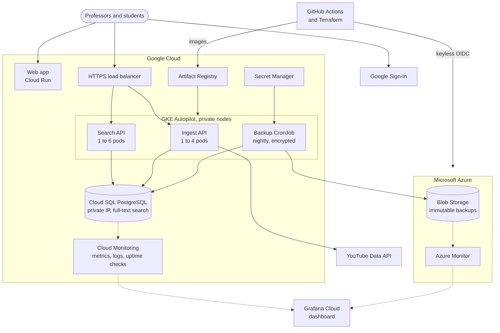

# Architecture

How Lecture Indexer (LI) is built and why. This page describes the system as deployed; what's left to do is in the [implementation plan](implementation-plan.md), and the larger decisions have their own [ADRs](architecture_decision_records/). Update the Decisions table as work lands.

## Architecture

The system as deployed. Solid arrows are requests and data, and dotted arrows are monitoring. To keep the diagram readable, Cloud SQL stands in for every Google Cloud service that reports to Cloud Monitoring, and the arrows from GitHub stand in for its keyless sign-in to both clouds.



Per the proposal:

- **Frontend**: React + Vite + TypeScript SPA served by nginx on **Cloud Run** (the proposal said Azure Static Web Apps; see [ADR 0001](architecture_decision_records/0001-frontend-on-cloud-run.md)); Google Sign-In (OAuth 2.0 / OIDC).
- **App tier**: two Flask services on GKE behind Cloud Load Balancing, **Ingest API** and **Search API**, each with its own HPA.
- **Data**: Cloud SQL for PostgreSQL (private IP), full-text search over timestamped caption segments.
- **Backups**: nightly K8s CronJob, and one before each pause → encrypted `pg_dump` → Azure Blob Storage (immutable, cool tier), create-only credential in Secret Manager ([ADR 0004](architecture_decision_records/0004-database-backups-to-azure.md)).
- **Platform**: Artifact Registry, Secret Manager + Workload Identity, Cloud Monitoring (log-based metrics and the backup alert; the other alerts are step 5).
- **Monitoring**: one [Grafana Cloud](monitoring/dashboard-links.md#grafana-cloud) dashboard over Cloud Monitoring and Azure Monitor, with read-only credentials held outside our clouds ([ADR 0005](architecture_decision_records/0005-monitoring-on-grafana-cloud.md)).
- **Delivery**: GitHub Actions with keyless OIDC to both clouds; Terraform for both providers.

## Decisions

| Decision | Why |
|---|---|
| **Flask** served by gunicorn (`--workers 2 --threads 4`), not FastAPI | Team choice. Each service is a `create_app()` factory plus one blueprint. What FastAPI would have given us lives in `li_common`: pydantic validation, JSON errors, a shared health blueprint. |
| **uv workspace** in `services/`, Python 3.12, `uv.lock` committed | One lockfile for both services and the shared package. |
| Images build from the **repo root** (`docker build -f services/ingest/Dockerfile .`) | The ingest image includes `db/migrations` for the migrate Job. |
| **Cloud SQL Auth Proxy** sidecar with `--auto-iam-authn` | The Cloud SQL Python Connector doesn't support psycopg. Services only see `DATABASE_URL` pointing at `127.0.0.1`. |
| **Numbered `.sql` migrations** run by `li-migrate`; no Alembic, no ORM | Small schema. Pending files apply in one transaction under an advisory lock. Runs as a K8s Job before each rollout. |
| Path prefixes **`/ingest/*`** and **`/search/*`** | One Ingress can route to both services. `/healthz` and `/readyz` stay unprefixed for probes. |
| ~~**Professor role** from the `PROFESSOR_EMAILS` allowlist; everyone else is a student~~ Superseded by [ADR 0002](architecture_decision_records/0002-invite-only-users-and-admin-roles.md): roles live in the database | Simple and auditable. Professors can only index videos from their own YouTube channel regardless. |
| **Ingestion runs inside the request** | The proposal has no queue. A lecture takes a few seconds; ingest's gunicorn timeout is 120 s. |
| **Dev auth** (`LI_DEV_AUTH=1`, `Authorization: Bearer dev:<email>`) | Local testing without Google. The services refuse to start with it inside Kubernetes. |
| Test files have **unique names** (e.g. `test_ingest_routes.py`) | pytest's default import mode needs unique basenames; `--import-mode=importlib` broke package imports. |
| **Database privileges via group roles**: `li_ingest_role` (read/write), `li_search_role` (read, plus claiming invitations at sign-in; its leftover `INSERT` on `users` is in the [to-do list](todo.md)) | Cloud SQL IAM users start with no privileges. Migration `0002` creates the roles; the migrate Job logs in as the built-in `li_admin` user (password in Secret Manager) and runs `li-migrate --grant` (`LI_MIGRATE_GRANTS`) to add each IAM user to its role. |
| **One deployed environment, named `prod`** (`envs/prod`, `overlays/prod`, GitHub environment `prod`, `rg-li-prod`) | It's the only environment and the one demoed, so it is production. The `modules/` + `envs/<name>/` layout is kept, so a throwaway second environment would just be another folder. |
| **One Terraform state bucket** in GCS for both clouds; `bootstrap/` and `envs/prod` are separate roots | Bootstrap (CI identities) is applied once by a human; `envs/prod` can be destroyed and recreated freely. The bucket itself is created with `gcloud` because Terraform needs it first. |
| **Keyless CI**: GCP Workload Identity pool restricted to this repo; Azure user-assigned managed identities with federated credentials | No service account keys or client secrets in CI. The only ones in the project are Grafana Cloud's read-only credentials, because it runs outside our clouds ([ADR 0005](architecture_decision_records/0005-monitoring-on-grafana-cloud.md)). |
| **Powerful CI identities only in the `prod` GitHub environment** (`github-terraform`, `github-deploy`, `id-li-github`); **read-only identities for PRs and the release's plan job** (`github-plan`, `id-li-github-plan`) | Bindings match the token's exact subject (`repo:…:environment:prod` vs `repo:…:pull_request` or `repo:…:environment:prod-plan`), so a workflow on a PR can't get write access. The `prod` environment requires an approval (self-approval allowed; repository admins may bypass it, a team decision of 2026-10-18) and only allows `main`. |
| **Pull requests into `main` are not enforced, and deploy self-approval is allowed** (for now) | Team choice. One person can push to `main` and approve their own deploy, so the `prod` approval is a deliberate confirmation step: check what changed on `main` (especially `.github/workflows/` and `infra/`) before approving. Tighten later with **Prevent self-review** or a PR ruleset on `main`; neither needs other changes. Deploys wait for CI to pass on the same commit before asking for approval. |
| **PR plans run `terraform plan -refresh=false -lock=false`** | The plan identities are read-only (GCP Viewer, Azure Reader). PR plans show what the code change does; the full refresh happens in the plan before each apply. Originally required because Reader couldn't refresh the Static Web App; kept after the move to Cloud Run. |
| **No secrets in Terraform state**: the `li_admin` password is an ephemeral `random_password` passed to write-only arguments (`password_wo`, `secret_data_wo`); rotate with `db_admin_password_version` | The PR plan identity can read state. Refreshes of write-only secrets also skip reading the value (checked in the provider source). No deploy tokens exist either: CI uses short-lived Workload Identity credentials. |
| **API hostname `<ip-with-dashes>.sslip.io`** on a reserved global IP | A Google-managed certificate needs a hostname; this avoids buying a domain. |
| **Private nodes and private-IP Cloud SQL**, Cloud NAT for outbound traffic | Nothing but the load balancer is reachable from the internet. NAT is needed for the backup upload to Azure Blob. |
| Terraform modules pass IAM members as **maps with static keys** | `for_each` keys must be known at plan time; member emails aren't until the service accounts exist. Caught by the mocked `terraform test`. |
| **Kubernetes values in one file**: `deploy/k8s/overlays/prod/values/values.env` → ConfigMap `li-config`, plus kustomize `replacements` for annotations, the hostname, and the secret name | Pods read values through `configMapKeyRef` and `$(VAR)` expansion; filling in production values after `terraform apply` is a one-file change. |
| **Cloud SQL Auth Proxy as a native sidecar** (`initContainers` with `restartPolicy: Always`) | Starts before the app and stops after it; in the migrate Job it exits on its own, so the Job can complete. |
| **Migrate Job in its own kustomization** (`deploy/k8s/migrate`, overlay `overlays/prod/migrate`) | The deploy workflow runs it to completion before rolling out the app. It reads the `li_admin` password from a Secret Manager-mounted file into `PGPASSWORD`, so the password is never in a URL or argument. |
| **Spot pods, read-only root filesystems, non-root, all capabilities dropped** | Cost and least privilege; gunicorn gets an in-memory `/tmp`. |
| **Frontend: React 19, Vite 8, React Router 8, TypeScript 6.0** | Current releases; TypeScript stays below 6.1 because typescript-eslint doesn't support newer yet. |
| **The Vite dev server proxies `/ingest` and `/search`** to the local APIs | The app uses the same paths locally and in production (`VITE_API_BASE` = the API host). |
| **Search excerpts are rendered without `innerHTML`**: the client splits `excerpt_html` on `<mark>` and emits text nodes | Defense in depth on top of the server's escaping. |
| **Search hits play in an embedded `youtube-nocookie.com` player** (a plain iframe, not the IFrame Player API), with the clip in the URL (`?q=…&v=…&t=…`) | Students stay on the site; only CSP `frame-src` grows, and `script-src` gets no YouTube script. Jumping to another timestamp reloads the player. Videos with embedding turned off are still indexed, and their hits link to youtube.com. |
| **Role detection**: the frontend calls `GET /ingest/me`, which returns `role` and `is_admin` | Roles stay server-side. Before [ADR 0002](architecture_decision_records/0002-invite-only-users-and-admin-roles.md) it called `GET /ingest/courses`, and a 403 meant student, so no extra endpoint was needed. |
| **The YouTube access token stays in browser memory** until shortly before it expires | One consent popup per session, never stored. |
| **Only YouTube's auto-generated (ASR) captions**, fetched with `captions.download`; tracks the creator uploaded are ignored, and users never upload caption files to us | One caption source, one format (WebVTT). A video without an ASR track fails with `422 no_captions`. |
| **Pause between test sessions instead of destroying**: `make cloud-pause` scales the pods to 0, deletes the Ingress (load balancer), and stops Cloud SQL; Terraform ignores `activation_policy` | Idle cost drops to ~$9/month (SQL storage, reserved IP), and the reserved IP, and with it the API hostname, survives. Destroying changes the hostname, which means editing `values.env`, the CSP and the OAuth origins. Ignoring the on/off state stops a CI apply from restarting a paused database. |
| **Workflows run on `ubuntu-24.04`**, not `ubuntu-latest` | `ubuntu-latest` moves to Ubuntu 26 from 2026-10-19; pinning keeps the runner image from changing under CI while the deploy workflows are written. Use the same label in new workflows, and upgrade all of them together on purpose. |
| **One release workflow per merge to `main`** (`release.yml`; [release process](release-process.md)): review sheet and real Terraform plan before **one** `prod` approval, then apply, backup, migrations, services and frontend in order | The first merge started three deploy workflows with three approvals, no ordering, and the plan only visible after approving. Now the plan comes from a read-only identity in a reviewer-less `prod-plan` environment, and the release applies that exact saved plan. Paused releases stop before asking for approval. |
| **Tag every release `prod-YYYY-MM-DD.N`** and create a GitHub Release | Base for the next review sheet (`make release-diff`), rollback target, record of what ran when. Every release pushes all four images, so every tag can be rolled back to. |
| **Automatic rollback where possible; `rollback.yml` for the rest** | Failed rollouts run `kubectl rollout undo`; the frontend gets traffic only after its candidate revision passes a check. `rollback.yml` redeploys a tag's images and config without migrations or Terraform. |
| **Backup before migrations; expand-then-contract migrations** | Migrations can't be rolled back, so a release with new migrations takes an on-demand Cloud SQL backup first (as `github-terraform`, whose Editor role allows it). Every migration must keep the previous release working, so a code rollback never needs a database rollback. |
| **Frontend on Cloud Run, not Azure Static Web Apps** ([ADR 0001](architecture_decision_records/0001-frontend-on-cloud-run.md)): nginx image (`frontend/Dockerfile`), service `li-frontend` (public, 0–2 instances), deployed with `gcloud run deploy` | The Azure for Students region policy allows none of the regions Static Web Apps is offered in. Cloud Run is a listed frontend host, scales to zero (~$0), and reuses Docker, Artifact Registry and the `github-deploy` identity, which gets `run.developer` on that one service only. nginx sets the CSP; its `connect-src` follows `VITE_API_BASE` at build time. Terraform ignores the deployed image. |
| **Azure resources in `northcentralus`** | The subscription may only deploy to five regions ([list](runbooks/bootstrap.md#prerequisites)); North Central US is closest to `us-central1`. |
| **The frontend build reads `API_HOSTNAME` and `GOOGLE_CLIENT_ID` from `values.env`** | One file to fill in after `terraform apply`, for the services and the frontend; no extra GitHub variables. |
| **Image tags are the commit SHA**, set with `kustomize edit set image` in the deploy job and never committed | Each rollout names exactly what's running. `make cloud-resume` therefore re-applies only the Ingress, not the overlay with its placeholder tags. |
| **Invite-only sign-in; roles in the database, set by admins** ([ADR 0002](architecture_decision_records/0002-invite-only-users-and-admin-roles.md)): `role` plus an `is_admin` flag (superuser merged into admin by [ADR 0003](architecture_decision_records/0003-merge-superuser-into-admin.md)); first admin via `li-admin create-admin`; Admin page backed by `/ingest/admin/users`; `user_audit` | Replaces the public `PROFESSOR_EMAILS` allowlist, which published emails, never demoted anyone, and needed a release per change. |
| `li_common.logs`, not `li_common.logging` | A module named `logging` shadows the standard library when Python runs from inside the package folder. |

## Terraform layout

```
infra/terraform/
├── .terraform-version        # 1.16.4 (tfenv)
├── bootstrap/                # once, by hand: GitHub OIDC for GCP + Azure, CI service accounts, Grafana's identities
├── grafana/                  # by hand: the dashboard, and no credentials
├── modules/
│   ├── gcp-network/          # VPC, pod/service ranges, private services access, Cloud NAT
│   ├── gke/                  # Autopilot, private nodes, least-privilege node SA, Secret Manager add-on
│   ├── cloudsql/             # Postgres 16 db-f1-micro, private IP, IAM auth, li_admin + IAM users
│   ├── artifact-registry/    # Docker repo with cleanup policies
│   ├── secrets/              # Secret Manager secrets with per-secret accessors
│   ├── cloud-run-frontend/   # nginx SPA on Cloud Run, public, deployers scoped to the service
│   ├── monitoring/           # the backup alert and log-based metrics; the other alerts are step 5
│   └── azure-backup-storage/ # used from bootstrap/, so backups survive destroying envs/prod
└── envs/prod/                # wires the modules; identities.tf (Workload Identity); tests/ (mocked)
```

## Kubernetes layout

```
deploy/k8s/
├── base/                 # namespace; ingest/ and search/ (ServiceAccount, Deployment, Service + BackendConfig, HPA);
│                         #   Ingress + ManagedCertificate + FrontendConfig; NetworkPolicies
├── migrate/              # ServiceAccount, SecretProviderClass (db-admin-password), Job
└── overlays/prod/        # app overlay (images); migrate/ overlay; values/ component (values.env → li-config)
```

Fill `overlays/prod/values/values.env` from `terraform output` (each line names its output) once the infrastructure exists. The deploy workflow sets image tags with `kustomize edit set image`.

## Frontend

React app with Google sign-in (or dev sign-in with `VITE_DEV_AUTH=1`), course list, course search with an embedded player, timestamped links and highlighted excerpts, a professor page to create courses and register or remove lectures, and an Admin page for invitations, roles and account status. Run it with `make frontend-dev` against the local APIs. Vitest tests cover the API client, excerpt rendering (including escaped markup staying text), search, lecture registration, and the Admin page.
